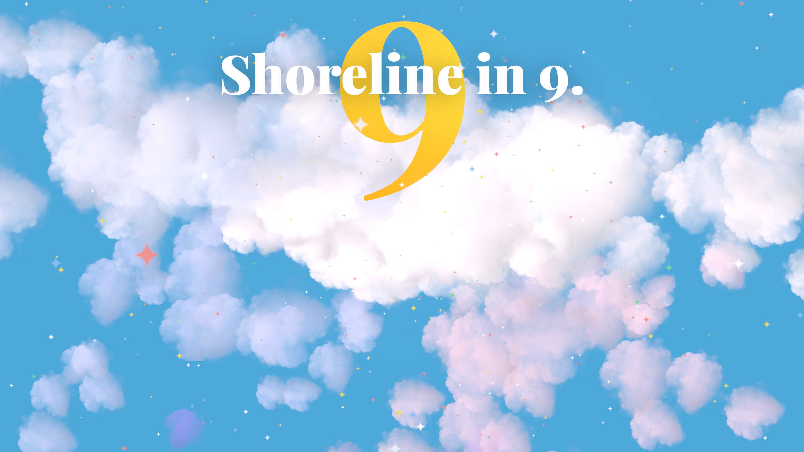
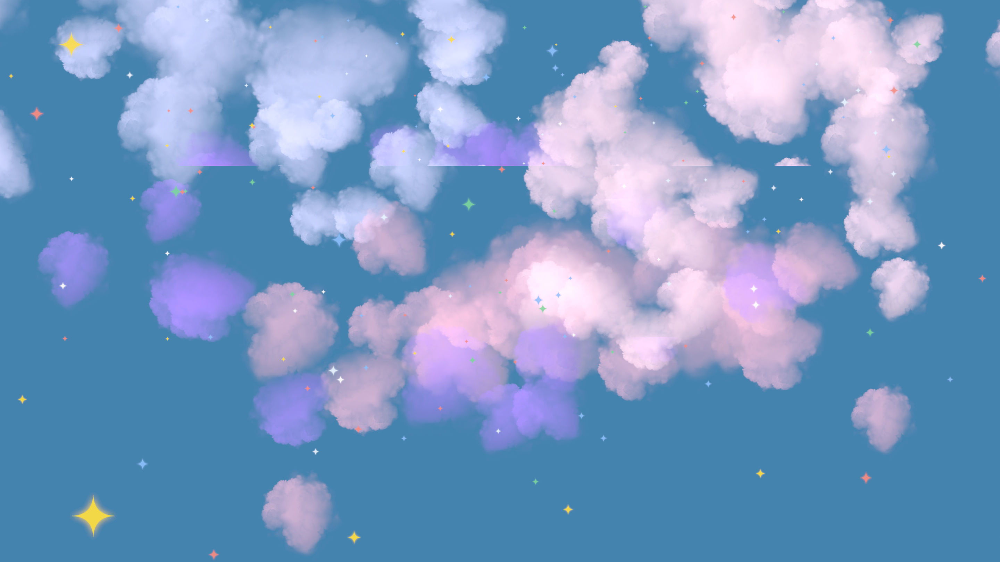
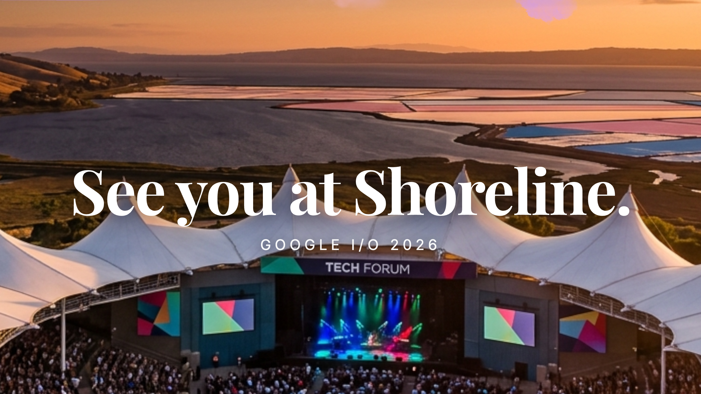

# Cloud 9 I/O Countdown


A scroll-driven 3D experience counting down to Google I/O 2026. Dive from a bright sky through volumetric clouds and sparkling Gemini star particles, descending into a golden sunset over Shoreline Amphitheatre.

## Quick Start

```bash
git clone https://github.com/andrewvoirol/ais-cloud-9-i-o-countdown.git
cd ais-cloud-9-i-o-countdown
npm install
npm run dev
```

Opens at [localhost:3000](http://localhost:3000). Scroll to fly.

## How It Works

Scroll down. The camera dives from a bright blue sky through layers of volumetric clouds into a twilight reveal of Shoreline Amphitheatre. Stars in Google's brand colors drift and dodge your cursor. The giant golden "9" floats above the cloud line, catching light like the sun.

Built with React Three Fiber's `ScrollControls` — the entire 3D scene (camera position, cloud parallax, background color, image opacity) is driven by a single scroll offset value interpolated through custom easing curves. Volumetric clouds use `@react-three/drei`'s raymarched `<Cloud>` components with organic drift animations. 800 Gemini star-shaped particles react to both scroll velocity and mouse proximity using per-frame CPU physics.

## Screenshots

| Sky & Clouds | Mid-Dive | Shoreline Reveal |
|:---:|:---:|:---:|
|  |  |  |

## Tech Stack

| | |
|---|---|
| **Framework** | React 19 + Vite 6 |
| **3D Engine** | Three.js via React Three Fiber |
| **Clouds & Text** | @react-three/drei |
| **Post-processing** | @react-three/postprocessing (Bloom) |
| **Styling** | Tailwind CSS v4 |
| **Language** | TypeScript |

## Project Structure

```
src/
├── App.tsx          # Scene, particles, clouds, scroll logic (single-file)
├── main.tsx         # React entry point
├── index.css        # Tailwind + fonts
└── assets/images/   # Shoreline Amphitheatre backdrop
```

No API keys needed. No backend. Pure client-side 3D.
